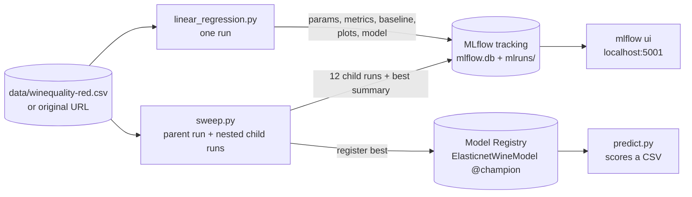
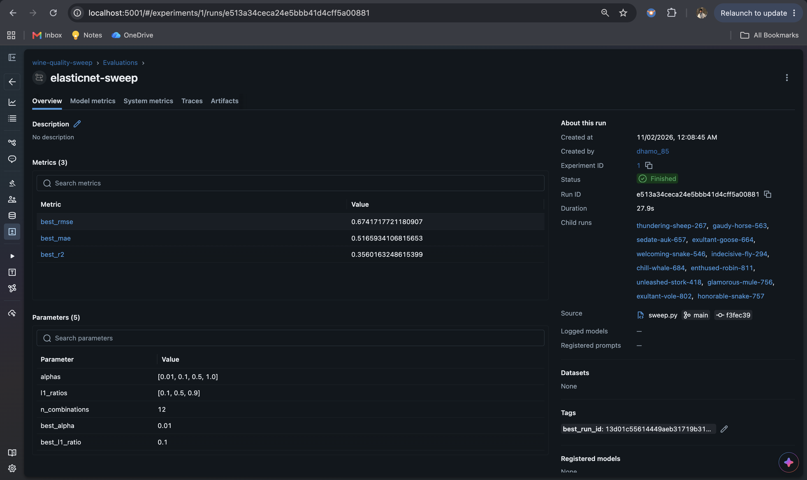
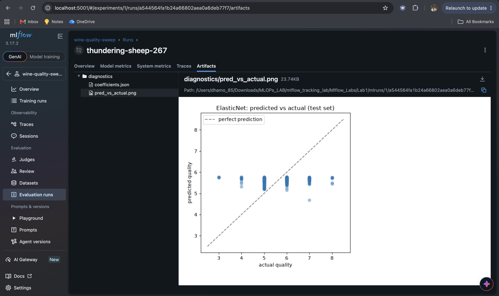
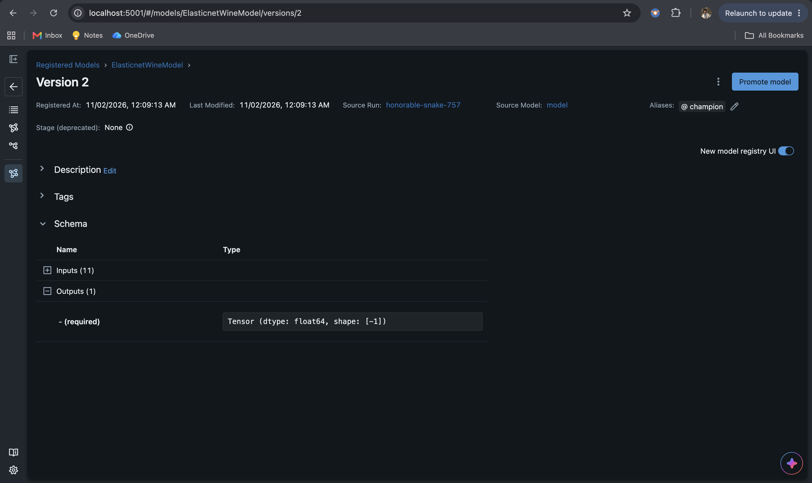
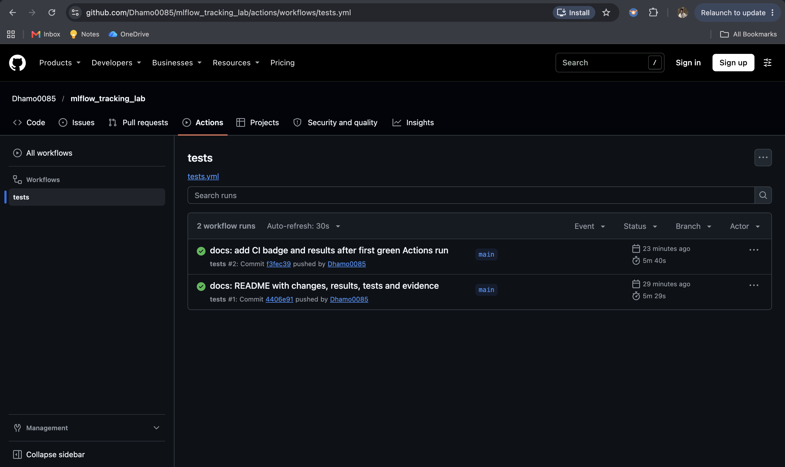

# mlflow_tracking_lab


> **Submission:** this is a single submission of the course's **MLflow Lab 1** (`Labs/Experiment_Tracking_Labs/Mlflow_Labs/Lab1`).

This repo extends **MLflow Lab 1** from Prof. Ramin Mohammadi's **MLOps course** (DADS 7305 / IE 7374, Northeastern University). In the original, `linear_regression.py` trains an ElasticNet model on the UCI red-wine-quality dataset and logs it to MLflow. Everything in the original still works, and its numbers are reproduced to every digit. On top of that I fixed 7 problems and added:

- a **mean-predictor baseline**, data lineage and diagnostic artifacts (coefficients and a predicted-vs-actual plot) on every run;
- a **hyperparameter sweep** (`sweep.py`) using nested MLflow runs, which registers the best model under the alias **`@champion`**;
- a **scoring script** (`predict.py`) that loads `models:/ElasticnetWineModel@champion` from the Model Registry;
- **52 tests** (the original had none) and GitHub Actions CI.

Original lab: [raminmohammadi/MLOps → Labs/Experiment_Tracking_Labs/Mlflow_Labs/Lab1](https://github.com/raminmohammadi/MLOps/tree/main/Labs/Experiment_Tracking_Labs/Mlflow_Labs/Lab1).

---

## Contents

1. [How it fits together](#1-how-it-fits-together)
2. [Quick start](#2-quick-start)
3. [Verify the changes yourself](#3-verify-the-changes-yourself)
4. [What I changed](#4-what-i-changed)
5. [Results](#5-results)
6. [Testing](#6-testing)
7. [Project structure](#7-project-structure)
8. [Screenshots](#8-screenshots)
9. [Design decisions](#9-design-decisions)
10. [Limitations and future work](#10-limitations-and-future-work)
11. [Credits](#11-credits)

---

## 1. How it fits together



---

## 2. Quick start

Python **3.12 or 3.13** (both tested locally on macOS: 3.12.14 and 3.13). The pinned numpy 2.5.4 and xgboost 3.4.1 have no Python 3.11 builds.

```bash
git clone https://github.com/Dhamo0085/mlflow_tracking_lab.git
cd mlflow_tracking_lab
python3 -m venv .venv
source .venv/bin/activate          # Windows: .venv\Scripts\activate
pip install -r requirements.txt
cd Mlflow_Labs/Lab1
```

```bash
python linear_regression.py              # original command, defaults alpha=0.5 l1_ratio=0.5
python linear_regression.py 0.1 0.9      # original positional arguments still work
python sweep.py                          # 4 x 3 grid, registers the best model as @champion
python predict.py data/sample_wines.csv  # scores with models:/ElasticnetWineModel@champion
mlflow ui --backend-store-uri sqlite:///mlflow.db --port 5001
```

Then open <http://localhost:5001>.

> **Why port 5001?** On recent macOS, port 5000 is taken by AirPlay Receiver (Control Center), and the browser gets HTTP 403 there. That's what happened when I tried it.

| Option | Meaning |
|---|---|
| `--data auto` (default) / `local` / `url` | Read the bundled CSV, or download from the original URL, or try local first and then the URL |
| `--experiment NAME` | Log to a named experiment |
| `--no-register` | Don't add a Model Registry version |
| `sweep.py --alphas 0.01 0.1 --l1-ratios 0.1 0.9` | Custom grid |
| `predict.py FILE --model-uri runs:/<run_id>/model --output preds.csv` | Score with any model; write a CSV |

Run the tests from the repo root:

```bash
pytest -q
```

> `serving.py` (unchanged from the original) needs xgboost, which on macOS needs the OpenMP runtime: `brew install libomp`. Without it, that one test is skipped; everything else works.

---

## 3. Verify the changes yourself

The first commit is the untouched original lab folder, copied byte-for-byte:
**`2863dba` `baseline: original MLflow Lab1 (unmodified)`**

```bash
git diff 2863dba..HEAD --stat
git log --oneline
```

| Commit | What it does |
|---|---|
| `2863dba` | baseline: original `Mlflow_Labs/Lab1`, unmodified |
| `81a6e03` | fix: offline data, input validation, clean errors (M1–M6) |
| `c086ba3` | feat: baseline metrics, diagnostics, sweep, registry-based predict |
| `321c239` | test, ci: 52 tests, pinned requirements, GitHub Actions |
| *(latest)* | docs: this README and captured evidence |

Raw output behind every number here is in [`docs/evidence/`](docs/evidence):

- [`linear_regression_before.txt`](docs/evidence/linear_regression_before.txt): the original script;
- [`linear_regression_after.txt`](docs/evidence/linear_regression_after.txt): the fixed script;
- [`new_scripts.txt`](docs/evidence/new_scripts.txt): train → sweep → predict;
- [`test_results.txt`](docs/evidence/test_results.txt): pytest and coverage.

---

## 4. What I changed

### 4a. Kept from the original

**Nothing was removed.**

| Area | Kept as-is |
|---|---|
| Command | `python linear_regression.py [alpha] [l1_ratio]`, defaults `0.5 0.5` |
| Model | `ElasticNet(alpha, l1_ratio, random_state=42)` |
| Data | Same UCI red-wine dataset and the same download URL (still available with `--data url`) |
| Split | Same 75/25 split, **the same rows**: the original used `np.random.seed(40)`, and `random_state=40` reproduces it exactly (a test checks this) |
| Metrics | Same `eval_metrics()` and the same names: `rmse`, `mae`, `r2`. The **values are identical to every digit** (RMSE 0.7931640229276851 for 0.5/0.5; a test checks this) |
| MLflow logging | Same params `alpha`, `l1_ratio`; the model is still registered as `ElasticnetWineModel` unless the tracking store is a plain file store |
| Other files | `serving.py`, all three notebooks, `requirements.txt`, `course_notes.pdf` and the images in `Mlflow_Labs/Lab1/` are **unchanged** |

### 4b. Problems fixed

| ID | Problem in original | Fix |
|---|---|---|
| M1 | If the CSV download failed, the script logged the error and then **crashed with `NameError: name 'data' is not defined`** (see `linear_regression_before.txt`) | `load_data()` raises a clear `DataLoadError`; the CLI prints one line and exits with code 2 |
| M2 | Bad arguments gave raw tracebacks: `-1` → sklearn `InvalidParameterError`, `0.5 1.5` → same, `abc` → `ValueError` | `argparse` + `validate_hyperparams()`: a one-line message such as `error: alpha must be a finite number >= 0 (got -1.0)`, exit code 2; NaN/inf rejected too |
| M3 | Printed `l2_ratio=` for the **l1**_ratio value | Label corrected |
| M4 | `warnings.filterwarnings("ignore")` hid **every** warning, including deprecations | Only MLflow `UserWarning`s are silenced |
| M5 | Every run needed internet | `data/winequality-red.csv` is a **byte-identical** copy of the URL's file (SHA-256 checked by a test); `--data auto` uses it and falls back to the URL |
| M6 | The split depended on hidden global state (`np.random.seed`) | Explicit `random_state=40`, which gives the same rows |
| M7 | Unpinned requirements, no tests, no CI | Pinned root `requirements.txt` (tested in fresh venvs), 52 tests, GitHub Actions |

Also updated for MLflow 3: `log_model(..., name="model")` instead of the positional artifact path.

### 4c. New features

| Area | Original | This version | Why it matters |
|---|---|---|---|
| Baseline | — | `baseline_rmse/mae/r2` (always predict the training mean) and `rmse_improvement_vs_baseline` on every run | Shows whether the model actually learned anything (0.793 vs 0.843 RMSE) |
| Run metadata | params + 3 metrics | Also `n_train`, `n_test`, `random_state`, tags `model_family`/`dataset`, and the **dataset logged as an MLflow input** | Lineage: you can see which data produced a run |
| Artifacts | model only | `diagnostics/coefficients.json` and `diagnostics/pred_vs_actual.png` | Inspect the model in the MLflow UI without code |
| Hyperparameter search | one run per manual command | `sweep.py`: grid as **nested runs** under one parent; parent logs `best_*` and `sweep_results.csv` | Compare 12 runs side by side in the UI |
| Model Registry | registers every run | The sweep registers the **best** model and sets alias **`@champion`** | The standard way to promote a model |
| Inference | — (separate `serving.py` demo only) | `predict.py` loads `models:/ElasticnetWineModel@champion`, checks columns against the logged signature, accepts `;` or `,` CSVs, reports RMSE if `quality` is present | End-to-end: train → register → use |
| CLI | positional only | `--data`, `--experiment`, `--no-register`; documented `--help` | Reproducible runs and named experiments |
| Offline use | needs internet | Bundled dataset | Works anywhere, including CI |
| Tests / CI | 0 / none | 52 tests; GitHub Actions on 3.12 + 3.13 with a train → sweep → predict smoke run | Every push is checked |

---

## 5. Results

From [`new_scripts.txt`](docs/evidence/new_scripts.txt) (fresh MLflow store, Python 3.12.14):

**Original command, unchanged numbers, plus the new baseline line**
```console
$ python linear_regression.py
Elasticnet model (alpha=0.500000, l1_ratio=0.500000):
  RMSE: 0.7931640229276851
  MAE: 0.6271946374319587
  R2: 0.10862644997792614
  baseline RMSE (predict the mean): 0.8426394848604892
```

**Sweep (4 alphas × 3 l1_ratios)**
```console
$ python sweep.py
Sweep results (best first):
 alpha  l1_ratio     rmse      mae       r2
  0.01       0.1 0.674172 0.516593 0.356016
  0.01       0.5 0.677856 0.519056 0.348959
  0.01       0.9 0.680342 0.521439 0.344175
  0.10       0.1 0.712883 0.546220 0.279938
  0.10       0.5 0.730900 0.561549 0.243081
  0.10       0.9 0.735315 0.566975 0.233909
  0.50       0.1 0.746055 0.576382 0.211366
  1.00       0.1 0.770160 0.601914 0.159581
  0.50       0.5 0.793164 0.627195 0.108626
  0.50       0.9 0.832375 0.666917 0.018316
  1.00       0.5 0.832824 0.668157 0.017256
  1.00       0.9 0.832884 0.671758 0.017116

Best: alpha=0.01, l1_ratio=0.1, RMSE=0.6742 (baseline RMSE 0.8426)
Registered ElasticnetWineModel version 2 as @champion
```

The best setting lowers test RMSE from **0.793** (the original defaults) to **0.674**. R² goes from 0.109 to 0.356.

**Scoring with the champion model**
```console
$ python predict.py data/sample_wines.csv
   quality  predicted_quality
0        7           5.925247
1        5           5.088180
...
7        7           6.221434
RMSE vs the 'quality' column: 0.5795 (MAE 0.4872, R2 0.4490)
```
(`sample_wines.csv` is 8 rows from the test split, so this RMSE is on only 8 wines.)

**Clean errors instead of tracebacks** (from `linear_regression_after.txt`)
```console
$ python linear_regression.py -1 0.5
error: alpha must be a finite number >= 0 (got -1.0)        [exit code 2]
$ python linear_regression.py 0.5 1.5
error: l1_ratio must be between 0 and 1 (got 1.5)           [exit code 2]
```

---

## 6. Testing

**Original: 0 tests → Now: 52 test cases** (41 test functions). Locally: **51 passed, 1 skipped** on Python 3.12.14 and on 3.13, in fresh virtualenvs.

| File | Cases | Covers |
|---|---:|---|
| `test_data_and_cli.py` | 27 | Bundled CSV is byte-identical to the original download; shape/target; **split equals the original `np.random.seed(40)` split**; local→URL fallback; offline error; CSV without target; valid/invalid hyperparameters (incl. NaN/inf); original positional args; exit codes |
| `test_tracking.py` | 14 | **Metrics identical to the original script's output**; original param/metric names; new params, baseline metrics, tags; dataset input; diagnostic artifacts (JSON + real PNG); model reload reproduces RMSE; signature; registry on/off; no run created for invalid input; `--experiment`; label typo fixed; script runs from another directory; **original `serving.py` still runs** |
| `test_sweep_and_predict.py` | 11 | One nested child run per combination; best = lowest RMSE; parent run summary + `sweep_results.csv`; `@champion` alias points at the best run; bad grid rejected before any run; `predict.py` CSV parsing (`;`/`,`), column/row errors, run-URI and champion scoring, `--output`, error exit codes |

Every test uses its own temporary SQLite tracking store and working folder, so the suite never touches your real `mlflow.db`.

**The skipped test:** `test_original_serving_script_still_runs` needs xgboost, which on macOS needs `libomp` (not installed on my machine). It runs in CI on Linux.

**Coverage** (`pytest --cov=Mlflow_Labs/Lab1 --cov-report=term-missing`, tests excluded; full output in [`test_results.txt`](docs/evidence/test_results.txt)):

| File | Stmts | Miss | Cover |
|---|---:|---:|---:|
| `linear_regression.py` | 147 | 1 | 99% |
| `sweep.py` | 62 | 2 | 97% |
| `predict.py` | 62 | 4 | 94% |
| `serving.py` (original, unchanged; its test is skipped locally) | 61 | 61 | 0% |
| **Total** | **332** | **68** | **80%** |

The new and changed code (the first three files) is at **97%** (264 of 271 statements). The 7 uncovered lines are the three `sys.exit(main())` entry-point lines, one defensive `except` branch in `predict.read_samples` (2 lines), and two print-only lines (the stdout table in `predict.py` and the registration message in `sweep.py`).

**CI:** [`.github/workflows/tests.yml`](.github/workflows/tests.yml) runs pytest with coverage on Python 3.12 and 3.13, then a real `linear_regression.py` → `sweep.py` → `predict.py` run.

---

## 7. Project structure

```
mlflow_tracking_lab/
├── .github/workflows/tests.yml     # CI: pytest + smoke run on 3.12 and 3.13
├── .gitignore                      # venv, caches, mlruns/, mlflow.db
├── .coveragerc                     # exclude tests from coverage
├── pytest.ini
├── requirements.txt                # pinned, tested versions
├── README.md
├── docs/
│   ├── evidence/                   # raw output quoted in this README
│   └── screenshots/                # MLflow UI + CI screenshots
└── Mlflow_Labs/Lab1/
    ├── linear_regression.py        # original script, fixed and extended
    ├── sweep.py                    # NEW: grid search with nested runs + @champion
    ├── predict.py                  # NEW: score a CSV with a registered model
    ├── data/
    │   ├── winequality-red.csv     # NEW: byte-identical copy of the original URL
    │   └── sample_wines.csv        # NEW: 8 rows for predict.py
    ├── tests/                      # NEW: conftest.py + 3 test files
    ├── serving.py                  # original, unchanged
    ├── linear_regression.ipynb     # original, unchanged
    ├── serving.ipynb               # original, unchanged
    ├── starter.ipynb               # original, unchanged
    ├── requirements.txt            # original, unchanged
    ├── course_notes.pdf            # original, unchanged
    └── *.png                       # original images, unchanged
```

---

## 8. Screenshots

> Screenshots still need to be added to [`docs/screenshots/`](docs/screenshots). The images below will show up once the files are committed.

| MLflow UI: sweep runs (nested) | MLflow UI: run artifacts |
|---|---|
|  |  |

| Model Registry: `@champion` | GitHub Actions run |
|---|---|
|  |  |

---

## 9. Design decisions

- **Keep the original script as the entry point.** The original command and output still work, so anyone following the course instructions gets the same result. The new behaviour is opt-in (`sweep.py`, `predict.py`, flags).
- **Bundle the data, keep the URL.** A local copy makes runs reproducible and CI-friendly. A SHA-256 test proves it is the very file the original downloads, so the switch can't silently change results.
- **Explicit seed with the same rows.** `random_state=40` gives exactly the split `np.random.seed(40)` produced. That makes the "metrics identical to the original" test possible.
- **Baseline on every run.** An RMSE of 0.79 means little alone. Next to the 0.84 of "always predict the mean", it shows the default model barely beats guessing, which motivates the sweep.
- **Nested runs plus an alias, not "register everything".** One parent per sweep keeps the UI tidy. `@champion` gives `predict.py` a stable name that follows the best model. A single `linear_regression.py` run still registers a version as the original did.
- **Return exit codes, don't crash.** `main()` returns 0/2/3, so the scripts behave well in shells and CI.

---

## 10. Limitations and future work

- **Linear model on a small dataset** (1,599 wines). Even the best ElasticNet explains only about 36% of the variance. Tree models would likely do better.
- **Grid search only.** A Bayesian search (e.g. Optuna logging to MLflow) would explore more efficiently.
- **Local tracking store** (SQLite + `mlruns/`). There is no remote tracking server or authentication.
- **Python 3.12+ only**, because of the pinned numpy/xgboost versions.
- **Not run on Windows.** The commands are standard, but only macOS was tested locally (CI uses Ubuntu).
- **Next steps:** `mlflow models serve` for the champion, cross-validation instead of a single split, and adding white wine as a feature.

---

## 11. Credits

- The original lab is from Prof. **Ramin Mohammadi**'s MLOps course at Northeastern University ([raminmohammadi/MLOps](https://github.com/raminmohammadi/MLOps), CC0-1.0). `serving.py`, the notebooks, `course_notes.pdf` and the images are theirs.
- Dataset: P. Cortez, A. Cerdeira, F. Almeida, T. Matos and J. Reis, *Modeling wine preferences by data mining from physicochemical properties*, Decision Support Systems 47(4), 2009 ([UCI](https://archive.ics.uci.edu/dataset/186/wine+quality)). The bundled CSV is the copy served from the MLflow repository.
- Adapted and extended by **Dhamodaran Selvam** ([@Dhamo0085](https://github.com/Dhamo0085)) as a course lab assignment.
